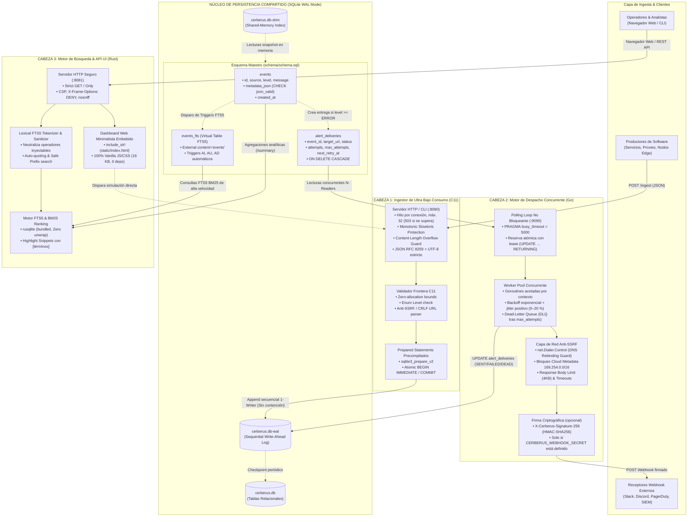

# Cerberus

Telemetría, alertas y búsqueda en tres lenguajes: C, Go y Rust, unidos por un solo archivo SQLite.

<p align="center">
  
  
  
  
  <a href="https://github.com/juancruzgentile/Cerberus/actions/workflows/ci.yml"></a>
</p>

Cerberus recibe eventos (logs, errores, avisos de seguridad), manda alertas por webhook cuando algo es grave y te deja
buscar en todo lo que llegó. Tiene tres "cabezas", cada una en el lenguaje que mejor le queda a su trabajo:

- **El ingestor, en C11**: recibe los eventos por HTTP y los guarda.
- **El alerter, en Go**: despacha los webhooks, con reintentos.
- **El buscador, en Rust**: búsqueda de texto completo y un dashboard web.

No hablan entre ellas por red ni por una cola: comparten una base **SQLite en modo WAL** con búsqueda **FTS5**.

Lo hice para aprender cómo se comportan tres lenguajes muy distintos trabajando sobre los mismos datos, y para
practicar seguridad en serio: cada ataque que se me ocurrió (o que apareció en las auditorías) tiene su prueba.

---

## Arquitectura

La pregunta de la que salió: ¿se puede recibir muchos eventos, mandar alertas con reintentos y buscar en texto libre
en una máquina chica, sin levantar Kafka, Redis o Elasticsearch? Mi respuesta fue un archivo SQLite y tres programas
chicos alrededor.



---

## Por qué un lenguaje distinto para cada parte

Ningún lenguaje es el mejor para todo, y quería ver eso en la práctica:

| Componente | Lenguaje | Por qué lo elegí | Qué hace |
|---|---|---|---|
| **`ingestor-c`** | **C11** | • Huella de memoria mínima (< 2 MB de RSS).<br/>• Cero pausas de *Garbage Collector*.<br/>• Acceso directo a llamadas al sistema POSIX (`socket`, `fcntl`, `clock_gettime`).<br/>• Compilación nativa con SQLite embebido. | Recibe y guarda los eventos. Es lo bastante liviano para correr en un contenedor chico o como demonio. |
| **`alerter-go`** | **Go 1.26** | • Modelo de concurrencia nativo con goroutines y canales.<br/>• Ecosistema de red maduro con control a nivel de socket (`net.Dialer.Control`).<br/>• Excelente manejo de cancelación distribuida con `context.Context`.<br/>• Compilación estática sin dependencias de runtime. | Manda los webhooks en paralelo, reintenta los que fallan y aparta los que no hay forma de entregar. |
| **`search-rust`** | **Rust 2021** | • Seguridad de memoria comprobada al compilar, sin GC.<br/>• Los errores van en el tipo (`Result<T, SearchError>`), así que no hay excepciones sueltas.<br/>• Sanitización léxica segura de consultas.<br/>• JSON con `serde`. | Expone la búsqueda de texto completo (FTS5, ordenada por BM25) y sirve el dashboard. |
| **Núcleo** | **SQLite (WAL)** | • Formato de archivo único, universal e independiente de arquitectura.<br/>• Modo WAL: 1 escritor exclusivo no bloquea a $N$ lectores concurrentes.<br/>• Extensión FTS5 nativa integrada con triggers automáticos. | Es donde se encuentran los tres: guarda todo y hace de cola, sin ningún servicio aparte. |

---

## Cómo conviven los tres con SQLite (modo WAL)

Todas las conexiones arrancan con:
```sql
PRAGMA journal_mode = WAL;
PRAGMA synchronous = NORMAL;
PRAGMA foreign_keys = ON;
PRAGMA busy_timeout = 5000;
```

En el modo clásico de SQLite (*rollback journal*), mientras alguien escribe nadie puede leer. Con **WAL** (Write-Ahead Logging) eso cambia:

1. **Lectores no bloquean a escritores:** `search-rust` puede estar ejecutando una consulta analítica pesada o un escaneo FTS5 mientras `ingestor-c` inserta nuevos eventos simultáneamente.
2. **Escritores no bloquean a lectores:** Cuando `ingestor-c` escribe, los cambios se anexan secuencialmente al archivo `cerberus.db-wal`. Los lectores (`alerter-go` y `search-rust`) continúan leyendo la última instantánea (*snapshot*) consistente desde `cerberus.db` y `cerberus.db-shm` (memoria compartida).
3. **Escritor único ordenado:** `ingestor-c` utiliza transacciones `BEGIN IMMEDIATE` y `alerter-go` actualiza el estado de la cola con `busy_timeout = 5000ms`, garantizando que ninguna actualización transaccional se pierda por colisión.

---

## Seguridad: qué ataques tuve en cuenta

Para cada ataque de esta tabla hay una defensa en el código y pruebas que la verifican. Eso no quiere decir que Cerberus no tenga vulnerabilidades: quiere decir que estas las cubrí.

| Ataque | Riesgo | Qué hace Cerberus | Dónde |
|---|---|---|---|
| **SSRF y DNS Rebinding** | Un atacante configura una URL de webhook apuntando a `169.254.169.254` (AWS/GCP metadata) o cambia dinámicamente el registro DNS a `127.0.0.1` tras la validación. | `net.Dialer.Control` intercepta y valida la IP física resuelta **antes** del handshake TCP. Bloqueo estricto de `169.254.0.0/16`, `100.100.100.200/32`, `fd00:ec2::254`, NAT64 `64:ff9b::/96`, `0.0.0.0/8`, y RFC1918. | `alerter-go` |
| **Open Redirect SSRF** | Un endpoint externo responde con `302 Found` redirigiendo al cliente hacia un servicio interno privado. | `http.Client.CheckRedirect` aborta inmediatamente cualquier intento de redirección HTTP. | `alerter-go` |
| **Inyección de Sintaxis FTS5** | Un usuario ingresa caracteres como `" OR 1=1 --`, `NEAR(...)`, `NOT AND OR` para alterar la lógica de búsqueda en SQLite. | Sanitizador léxico en Rust (`sanitize_fts5_query`) que extrae tokens válidos, aplica prefijo seguro `*` y envuelve cada término entre comillas escapadas, limitando a un máximo de 16 tokens (`MAX_QUERY_TOKENS`). | `search-rust` |
| **Denegación de Servicio por Deep-Pagination** | Peticiones con `offset = usize::MAX` o valores astronómicos causan integer overflow en la conversión a `i64` o consumo masivo de CPU. | Validación estricta con `MAX_OFFSET = 100_000` y límite `limit <= 100`. | `search-rust` |
| **Slowloris / Conexiones Lentas** | Un cliente envía 1 byte cada varios segundos para agotar el pool de descriptores del servidor HTTP en C11. | Doble control: timeout por socket `SO_RCVTIMEO` / `SO_SNDTIMEO` sumado a un temporizador monotónico total de pared (`clock_gettime(CLOCK_MONOTONIC)`) de 2000 ms. | `ingestor-c` |
| **Contrabando HTTP e Integer Overflow** | Cabeceras `Content-Length` malformadas, duplicadas o con valores superiores a `SIZE_MAX`. | Parser manual dígito a dígito en C11 con cota fija de 32 KB (`MAX_HTTP_REQ_SIZE`), Respuestas: valor no numérico, negativo o duplicado → `400`; cuerpo > 32 KB → `413`; `POST` sin `Content-Length` → `411`; `Transfer-Encoding` → `400`. | `ingestor-c` |
| **Falsificación de Alertas (Tampering)** | El receptor del webhook no puede verificar si la alerta realmente proviene de Cerberus. | Firma HMAC-SHA256 en `X-Cerberus-Signature-256` **solo si** se define `CERBERUS_WEBHOOK_SECRET`. Sin secreto los webhooks salen **sin firma** (el alerter lo advierte al arrancar). | `alerter-go` |
| **JSON / Unicode malformado** | Texto con UTF-8 inválido o JSON roto se guarda y luego rompe a los lectores. | Parser JSON completo (RFC 8259) en C: valida todo el documento (también campos ignorados), UTF-8 estricto (RFC 3629) y decodifica `\uXXXX` con pares sustitutos. Rust lee filas antiguas inválidas sin fallar (U+FFFD). Reparación: `tools/repair_utf8.py`. | `ingestor-c`, `search-rust` |
| **Escritura cross-site (CSRF)** | Una página web cualquiera hace `POST` al ingestor local desde el navegador de la víctima. | `POST /ingest` exige `Content-Type: application/json` (`415` si no) y rechaza cualquier `Origin` no configurado (`403`). CORS solo para los orígenes de `--cors-origin` (el dashboard). | `ingestor-c` |
| **Entregas duplicadas** | Dos instancias del alerter envían la misma alerta. | Reserva atómica con vencimiento; el `UPDATE` final solo aplica si el lease sigue siendo propio. Ver *Garantías de entrega*. | `alerter-go` |
| **Inyección de Código XSS** | Mensajes o orígenes con `<script>alert(1)</script>` almacenados en SQLite se renderizan en el navegador. | Cabeceras de seguridad estrictas (`Content-Security-Policy`, `X-Frame-Options: DENY`, `nosniff`) y renderizado DOM exclusivamente con `escapeHtml` y creación segura de nodos de texto. | `search-rust` (UI) |

---

## Dashboard

El buscador trae un dashboard web: un solo archivo HTML con CSS y JS a mano (16 KB, sin dependencias) metido dentro del binario de Rust con `include_str!`.

```text
┌────────────────────────────────────────────────────────────────────────────────────────┐
│ 🟢 CERBERUS Telemetry & Security     [C11 :8080] [Go :9090] [Rust :8081] [SQLite WAL]  │
├────────────────────────────────────────────────────────────────────────────────────────┤
│ TOTAL EVENTS: 1,420 │ CRITICAL/ERR: 12 │ WEBHOOKS SENT: 12 │ DEAD-LETTER QUEUE: 0      │
├─────────────────────────────────────┬──────────────────────────────────────────────────┤
│ SIMULADOR DE INGESTA (C11)          │ BÚSQUEDA EN VIVO FTS5 & EVENT STREAM             │
│                                     │ ┌───────────────────────────────┐ ┌────────────┐ │
│ Source:   [payment-api            ] │ │ q: timeout*                   │ │ [CRITICAL] ▼│ │
│ Level:    [CRITICAL             ▼]  │ └───────────────────────────────┘ └────────────┘ │
│ Message:  [Gateway timeout 5000ms ] │ #12 [CRITICAL] payment-api [timeout] in ledger   │
│ Webhook:  [https://webhook.site/..] │ #11 [ERROR]    auth-service DB connection [time] │
│                                     │ #10 [INFO]     worker-node CPU ok (45%)          │
│ [ INGEST VIA C11 ]                  │                                                  │
│ ✔ Event #12 ingested successfully! │ Mostrando coincidencias ordenadas por BM25       │
└─────────────────────────────────────┴──────────────────────────────────────────────────┘
```

* Está en `http://127.0.0.1:8081` apenas arranca todo.
* Las métricas se actualizan solas cada 3 segundos.
* La búsqueda espera 250 ms a que dejes de escribir y resalta los términos que encontró FTS5.

---

## Cómo probarlo (`cerberus.sh`)

Para no tener que abrir tres terminales, hice un lanzador que se encarga de todo:

### 1. Verificar herramientas instaladas
```bash
./cerberus.sh check
```
Comprueba presencia **y versión mínima**: `python3` (>=3.10), `make` (>=4.0), `go` (>=1.26, descargada automáticamente vía `GOTOOLCHAIN=auto`), `rustc`/`cargo` (>=1.89), además de `cc` (C11), `curl` y `flock` (obligatorios para `start`). Sale con error si falta algo o la versión es menor.

### 2. Iniciar el sistema completo
```bash
./cerberus.sh start
```
Compila lo que falte y levanta las tres cabezas en segundo plano:
* **Ingestor C11:** `http://127.0.0.1:8080` (endpoints `POST /ingest`, `GET /health`)
* **Alerter Go:** `http://127.0.0.1:9090` (endpoints `GET /health`, `GET /stats`)
* **Search Rust & Web UI:** `http://127.0.0.1:8081` (interfaz visual en `/`, `GET /search`, `GET /summary`)

### 3. Abrir el dashboard
Entrá a **[http://127.0.0.1:8081](http://127.0.0.1:8081)**.

### 4. Ver una demo
```bash
./cerberus.sh demo
```
Mete eventos de prueba por el ingestor, hace búsquedas en el buscador y muestra cómo quedaron las alertas.

### 5. Estado, logs y apagado
```bash
./cerberus.sh status   # qué está corriendo y con qué PID
./cerberus.sh logs     # las últimas líneas de log de los tres
./cerberus.sh stop     # apaga todo de forma ordenada
./cerberus.sh restart  # stop + start
```

El lanzador solo detiene procesos suyos: cada archivo PID guarda `pid`, tiempo de inicio y binario, y se verifican contra `/proc` antes de enviar señales (un PID reutilizado por otro programa nunca se mata). Un lock (`flock`) impide dos `start`/`stop` simultáneos, cada servicio tiene un plazo total de arranque (`CERBERUS_HEALTH_TIMEOUT`, 10 s) y, si uno falla, se detienen solo los servicios iniciados en ese intento.

### Qué garantiza la entrega de alertas

* **Al menos una vez (at-least-once).** Cada entrega se reserva de forma atómica (`UPDATE … RETURNING` que mueve `next_retry_at` al vencimiento del lease); otra instancia no puede tomarla mientras el lease esté vigente. Si el proceso muere a mitad de envío, la entrega se reintenta al vencer el lease, por lo que **el receptor puede recibir duplicados**.
* **Idempotencia en el receptor:** todas las peticiones llevan `Idempotency-Key: cerberus-delivery-<id>` y `X-Cerberus-Delivery-ID`, estables entre reintentos. El receptor debe descartar claves ya procesadas.
* **Backoff:** `base · 2^(intento-1)` más un jitter positivo de 0–20 %, con tope en `MaxBackoff` (no es *Full Jitter*).
* **Firma:** HMAC-SHA256 solo con `CERBERUS_WEBHOOK_SECRET`; sin él, los mensajes van sin firma.

---

## API HTTP

### 1. Ingestor (`ingestor-c` en puerto `8080`)
* **`POST /ingest`**: guarda un evento nuevo.
  ```bash
  curl -X POST http://127.0.0.1:8080/ingest \
    -H 'Content-Type: application/json' \
    -d '{
      "source": "payment-api",
      "level": "CRITICAL",
      "message": "Stripe API timeout after 5000ms",
      "metadata": {"transaction_id": "tx_9941", "retry": 3},
      "webhook_url": "https://hooks.example.com/alerts"
    }'
  ```
  **Respuesta:** `201 Created` / `{"status":"ok","event_id":142}`

  Errores: `400` JSON inválido (todo el documento se valida), UTF-8 inválido, campos faltantes/duplicados, byte NUL o `Content-Length` malformado/negativo/duplicado · `403` `Origin` no permitido · `411` sin `Content-Length` · `413` cuerpo > 32 KB · `415` `Content-Type` distinto de `application/json` · `503` más de 32 conexiones simultáneas.
* **`OPTIONS /ingest`**: preflight CORS. `204` con `Access-Control-Allow-*` solo para orígenes dados con `--cors-origin` (el lanzador pasa el del dashboard); `403` para el resto.
* **`GET /health`**: `200 OK` `{"status":"ok","service":"cerberus-ingestor"}`

### 2. Buscador & Analítica (`search-rust` en puerto `8081`)
* Opción `--ingest-url http://127.0.0.1:<puerto>`: URL del ingestor que usa el simulador del dashboard (el lanzador la pasa según `CERBERUS_INGEST_PORT`). Atiende hasta 32 conexiones en paralelo.
* **`GET /search?q=timeout*&level=CRITICAL&limit=10&offset=0`**: búsqueda de texto completo, ordenada por BM25 y con fragmentos resaltados.
  ```json
  {
    "sanitized_query": "\"timeout\"*",
    "level": "CRITICAL",
    "source": null,
    "limit": 10,
    "offset": 0,
    "count": 1,
    "total_matches": 1,
    "results": [
      {
        "id": 142,
        "source": "payment-api",
        "level": "CRITICAL",
        "message": "Stripe API timeout after 5000ms",
        "snippet": "Stripe API [timeout] after 5000ms",
        "metadata_json": "{\"transaction_id\":\"tx_9941\",\"retry\":3}",
        "created_at": 1793140341,
        "rank": -1.0620689655172414e-6
      }
    ]
  }
  ```
* **`GET /summary`**: totales por severidad, los orígenes con más eventos y el estado de la cola de webhooks.
* **`GET /`**: el dashboard.

### 3. Observabilidad de Alertas (`alerter-go` en puerto `9090`)
* **`GET /stats`**: cómo van las entregas de webhooks:
  ```json
  {"pending": 0, "sent": 14, "failed": 1, "dead": 0, "total": 15}
  ```

---

## Pruebas

Todas se corren con:
```bash
make test
```

| Módulo | Funcionamiento | Ataques | Cantidad |
|---|---|---|---|
| **`schema/`** | • WAL mode & Foreign Keys activas.<br/>• CRUD y sincronización FTS5 por triggers.<br/>• Restricciones de longitud y niveles.<br/>• Borrado en cascada `ON DELETE CASCADE`. | • Payloads de inyección SQL en todos los campos.<br/>• Bombas lógicas (>16KB JSON, >8KB texto).<br/>• Rechazo de JSON escalar/arrays.<br/>• Bloqueo de SSRF y URLs malformadas.<br/>• Auditoría de permisos `0600` e higiene de secretos. | **9 / 9 PASS** |
| **`ingestor-c/`** | • Permisos restrictivos `0600` en `.db`.<br/>• Inserción de 5 niveles de severidad.<br/>• Reglas de creación atómica en `alert_deliveries`.<br/>• Ingesta masiva por lotes (`cerberus_ingest_batch`) y *rollback* ante fallo.<br/>• Self-test integrado en el binario CLI. | • Inmunidad ante `SIGPIPE` en desconexiones abruptas.<br/>• Desbordamiento de enteros en `Content-Length`.<br/>• Bloqueo de payloads de 100 KB (`413 Payload Too Large`).<br/>• Ataques Slowloris y clientes lentos.<br/>• Evasión de SSRF con IPs decimales/hexadecimales.<br/>• Regresiones de auditoría: UTF-8 inválido, `\uXXXX`/emoji, JSON inválido en campos ignorados, CORS, conexión ociosa, 64 ingestas en paralelo, permisos con `umask 022`, URIs `file:` rechazadas, apagado con base bloqueada (SIGTERM cancela, responde `503` y cierra SQLite solo sin hilos activos), petición válida que termina durante la gracia (`201`, un único evento). | **26 tests + autotest** |
| **`alerter-go/`** | • Entrega exitosa con verificación de firma HMAC-SHA256.<br/>• Recuperación tras fallo transitorio (`500` / timeout).<br/>• Transición automática a Dead-Letter Queue (`DEAD`).<br/>• Worker pool concurrente (26 alertas simultáneas sin `SQLITE_BUSY`). | • Bloqueo de DNS Rebinding en `net.Dialer.Control`.<br/>• Bloqueo de Open Redirect (`301`/`302`/`303`/`307`/`308`, cada código verificado).<br/>• Bombas de respuesta HTTP de 10 MB (Tar Pit).<br/>• Truncamiento seguro de errores en límites de runes UTF-8.<br/>• Timeouts de cabecera anti-Slowloris en métricas.<br/>• Regresiones: dos instancias sin entregas duplicadas, lease perdido, base `0600` con rutas normales y URIs `file:` (los nombres con `mode=memory` ya no se saltan la política; `vfs`, `mode=ro` y hosts remotos se rechazan; `file::memory:disk` es un archivo y queda `0600`). | **19 tests** |
| **`search-rust/`** | • Indexación y ordenamiento por relevancia BM25.<br/>• Búsqueda por prefijo seguro (`timeout*`).<br/>• Paginación multi-página con `total_matches`.<br/>• Validación de límites `limit` y `offset`.<br/>• Resumen analítico tipado (`get_summary`). | • Inyección de operadores FTS5 y comillas desbalanceadas.<br/>• Bloqueo de bytes nulos `%00` y caracteres de control.<br/>• DoS por bombas de tokens (`MAX_QUERY_TOKENS = 16`).<br/>• Desbordamiento de paginación (`MAX_OFFSET = 100_000`).<br/>• Enmascaramiento de errores internos en respuestas `500`.<br/>• Regresiones: filas con UTF-8 inválido, base `0600`, conexión ociosa, URL del ingestor configurable, URIs `file:` rechazadas (incluidas `file::memory:` y sufijos como `file::memory:disk`; solo `:memory:` es memoria). | **26 tests** |
| **E2E Pipeline** | • **Flujo Completo Políglota:** C11 ingesta eventos → Go despacha webhooks firmados con verificación HMAC → Rust indexa y entrega resultados FTS5 → flujo del dashboard (preflight CORS + POST con `Origin`). | — | **1 test** |
| **`cerberus.sh`** | • `start` completo con los 3 servicios y `status`. | • Puerto ocupado por un servidor ajeno que responde `200` en `/health`: el arranque falla, se revierte y el proceso ajeno no se toca.<br/>• Proceso propio vivo pero sin el socket del puerto: `wait_health` lo rechaza.<br/>• Binario reemplazado mientras corre: `stop` lo sigue deteniendo (identidad por dispositivo:inodo).<br/>• Registro de un proceso vivo sin propiedad acreditada: no se mata, se conserva y `stop`/`start` fallan.<br/>• PID reutilizado: registro obsoleto eliminado sin matar nada.<br/>• Registros PID del formato anterior, con y sin espacios en la ruta: se siguen deteniendo; si apuntan a un proceso ajeno, se conservan.<br/>• Se ejecutan sobre una copia temporal del lanzador y los binarios, en una ruta con espacios. | **11 tests** |

GitHub Actions las corre en cada push y pull request (`.github/workflows/ci.yml`), y el badge de arriba muestra cómo quedó el último commit de `main`. La E2E imita las peticiones del navegador, pero no abre un navegador de verdad.

---

## Estructura

```text
Cerberus/
├── cerberus.sh               # Lanzador (check, build, start, stop, restart, status, logs, demo)
├── Makefile                  # Orquestador Make para compilación y pruebas globales
├── requirements.txt          # Requisitos de toolchain del sistema (0 dependencias PyPI)
├── schema/
│   ├── schema.sql            # Esquema maestro SQLite WAL + FTS5 + Triggers
│   ├── test_schema.py        # Pruebas funcionales de base de datos
│   └── test_security_schema.py# Pruebas de inyección y ataques a nivel de esquema
├── ingestor-c/               # Cabeza 1: Ingestor de baja latencia en C11
│   ├── include/              # API pública (cerberus_ingestor.h)
│   ├── src/                  # Implementación del ingestor y servidor HTTP
│   ├── tests/                # Pruebas C11 y suite de ataque contra el servidor HTTP
│   └── vendor/               # Amalgamación SQLite3 oficial (compilada localmente)
├── alerter-go/               # Cabeza 2: Despachador de alertas y webhooks en Go
│   ├── cmd/alerter/          # Punto de entrada y servidor de observabilidad
│   └── internal/dispatcher/  # Worker pool, lógica de reintentos y filtro anti-SSRF
├── search-rust/              # Cabeza 3: Buscador FTS5 y analítica en Rust
│   ├── src/                  # Motor de búsqueda, sanitizador FTS5 y servidor HTTP
│   ├── src/static/           # Dashboard Web minimalista embebido (index.html)
│   └── tests/                # Pruebas de integración y pruebas de ataque
├── tools/
│   └── repair_utf8.py        # Detecta/repara filas antiguas con UTF-8 inválido
├── tests/
│   ├── test_e2e_cerberus.py  # Prueba end-to-end de las tres cabezas
│   └── test_launcher.py      # Pruebas del lanzador
└── .github/                  # CI (GitHub Actions) y Dependabot
```

---

## Cómo lo hice

Cerberus lo armé con [Claude Code](https://claude.com/claude-code), el asistente de programación de Anthropic. La idea,
el diseño de las tres cabezas y qué tenía que resistir los decidí yo; gran parte del código, las pruebas y esta
documentación los fue escribiendo Claude Code con lo que yo le pedía y le corregía. Después le hice auditar el
proyecto varias veces: lo que encontró y cómo se arregló está en [`correcciones.txt`](correcciones.txt).

## Licencia

MIT (ver [`LICENSE`](LICENSE)). Usalo para aprender, investigar o como base de lo que quieras.
