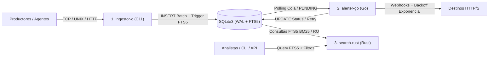

# Cerberus — Polyglot Telemetry, Alerting & Search Engine

**Cerberus** es un sistema de telemetría, alerta temprana y búsqueda de eventos de seguridad de alto rendimiento diseñado bajo una arquitectura políglota de tres cabezas (**C**, **Go** y **Rust**) sincronizadas a través de un motor de base de datos compartido **SQLite en modo WAL (Write-Ahead Logging)** con indexación de texto completo **FTS5**.

---

## Arquitectura del Sistema (Las 3 Cabezas)



### 1. `ingestor-c` (C11) — Ingesta de Baja Latencia
- **Responsabilidad**: Recepción, validación estricta en frontera y persistencia transaccional de eventos (`DEBUG`, `INFO`, `WARN`, `ERROR`, `CRITICAL`).
- **Diseño**: Cero dependencias innecesarias, uso de *prepared statements* parametrizados (`sqlite3_prepare_v2`), manejo seguro de memoria y generación automática de órdenes de despacho en `alert_deliveries` para eventos críticos.

### 2. `alerter-go` (Go) — Despachador Concurrente y Resiliente
- **Responsabilidad**: Procesamiento asíncrono de la cola `alert_deliveries`, envío de webhooks con *exponential backoff* + *jitter* y transición de estados (`PENDING` -> `SENT` / `FAILED` / `DEAD`).
- **Diseño**: *Worker pool* controlado por contexto (`context.Context`), *timeouts* estrictos de red, protección contra fugas de goroutines y cierre limpio (*graceful shutdown*).

### 3. `search-rust` (Rust) — Motor de Búsqueda Full-Text y Analítica
- **Responsabilidad**: Búsqueda ultrarrápida sobre eventos históricos utilizando el índice virtual **SQLite FTS5** (ranking BM25), filtrado por severidad, origen y rangos temporales.
- **Diseño**: Seguridad de memoria garantizada por el compilador, consultas parametrizadas de solo lectura o baja contención, y manejo explícito de errores sin `unwrap()` en rutas de producción.

### Núcleo Compartido: `schema/schema.sql` (SQLite WAL + FTS5)
- **Concurrencia**: `PRAGMA journal_mode = WAL;` permite múltiples lectores concurrentes (`search-rust`, `alerter-go`) mientras `ingestor-c` escribe sin bloqueos mutuos, apoyado por `PRAGMA busy_timeout = 5000;`.
- **Integridad en Base de Datos**: Restricciones `CHECK` a nivel de esquema para longitud de campos, validación nativa de JSON (`json_valid(metadata_json)`), enumeraciones de nivel/estado y llaves foráneas (`ON DELETE CASCADE`).
- **Sincronización FTS5 Automática**: Tabla virtual `events_fts` en modo *external content* (`content='events'`) mantenida en tiempo real mediante triggers `AFTER INSERT`, `AFTER DELETE` y `AFTER UPDATE`.

---

## Estructura del Proyecto

```text
Cerberus/
├── Makefile              # Orquestación: build / test / e2e / clean
├── schema/
│   ├── schema.sql        # Esquema maestro SQLite WAL + FTS5 + Triggers
│   └── test_*.py         # Tests funcionales y de seguridad del esquema
├── ingestor-c/           # Cabeza 1: Ingestor de eventos en C11 (+ tests C y ataques)
├── alerter-go/           # Cabeza 2: Motor de alertas con reintentos en Go (+ tests)
├── search-rust/          # Cabeza 3: Buscador FTS5 y analítica en Rust (+ tests)
└── tests/
    └── test_e2e_cerberus.py  # Integración End-to-End de las 3 cabezas
```

---

## Requisitos

| Herramienta | Versión probada |
|-------------|-----------------|
| Compilador C (gcc / clang) | C11 |
| Go | 1.23+ |
| Rust / Cargo | 1.80+ |
| Python 3 | 3.10+ (solo para tests) |
| GNU Make | 4.x |

SQLite se compila **embebido** en cada cabeza (amalgamación en C, `rusqlite` *bundled* en Rust y `modernc.org/sqlite` puro Go): no hace falta instalar SQLite en el sistema.

## Compilación y pruebas

```bash
make build   # compila las 3 cabezas
make test    # esquema -> C11 -> Go -> Rust -> E2E políglota
make e2e     # solo la integración End-to-End
make clean
```

## Ejecución de las 3 cabezas sobre la misma base

```bash
# 1) Ingestor C11 (HTTP en 127.0.0.1:8080)
./ingestor-c/bin/cerberus-ingestor --db cerberus.db --schema schema/schema.sql --serve 8080

curl -X POST http://127.0.0.1:8080/ingest -H 'Content-Type: application/json' \
  -d '{"source":"payment-api","level":"CRITICAL","message":"Gateway timeout","webhook_url":"https://hooks.example.com/cerberus"}'

# 2) Despachador Go (firma HMAC opcional, métricas en :9090)
CERBERUS_WEBHOOK_SECRET='cambia-esto' ./alerter-go/bin/cerberus-alerter \
  --db cerberus.db --workers 4 --metrics-addr 127.0.0.1:9090

# 3) Buscador Rust (HTTP en 127.0.0.1:8081)
./search-rust/target/release/cerberus-search --db cerberus.db --serve 8081
curl 'http://127.0.0.1:8081/search?q=timeout*&level=CRITICAL'
curl 'http://127.0.0.1:8081/summary'
```

> **Seguridad por defecto:** `cerberus-alerter` bloquea webhooks hacia loopback y redes privadas (RFC1918). Para desarrollo local use `--allow-loopback` / `--allow-private` explícitamente.

## Cobertura de pruebas

| Módulo | Funcionales | Seguridad / ataque |
|--------|-------------|--------------------|
| `schema/` | 5 | 4 (SQLi, JSON bombs, SSRF, higiene de repo) |
| `ingestor-c/` | 5 + self-test | 6 (overflow 100KB, Content-Length, Slowloris, SSRF/CRLF, RST) |
| `alerter-go/` | 5 | 6 (DNS rebinding, open redirect, response bomb, tar pit, SQLi, métricas) |
| `search-rust/` | 14 | 5 (inyección FTS5, bytes nulos, DoS de tokens/offset, fuga de errores 500) |
| `tests/` E2E | 1 pipeline completo C → Go → Rust con HMAC, DLQ y BM25 | |

---

## Gobernanza de Seguridad y Calidad (Equipo Cerberus)

1. **Defensa en Profundidad y Cero SQL Injection**:
   - Prohibida la interpolación de cadenas para construir SQL en cualquiera de los tres lenguajes. Todas las consultas usan parámetros enlazados (`?1`, `?2`, etc.).
2. **Validación Estricta de Datos**:
   - Límites de tamaño impuestos tanto en código como en las cláusulas `CHECK` de SQLite (`source <= 128`, `message <= 8192`, `metadata_json <= 16384` y válido según `json_valid`).
3. **Seguridad de Memoria y Recursos**:
   - **C**: Compilación limpia con `-Wall -Wextra -Werror -pedantic -O2`, verificación de retornos de asignaciones y cierre determinista de *statements* y descriptores.
   - **Go**: Clientes HTTP con `Timeout` estricto, límite de lectura de cuerpo de respuesta (`io.LimitReader`) y validación de esquemas `http://` o `https://`.
   - **Rust**: Tipado fuerte, manejo de errores con `Result<T, E>` y prevención de inyecciones en sintaxis de consulta FTS5.
4. **Higiene de Secretos y Permisos**:
   - Ninguna credencial o base de datos operativa se versiona en Git. Archivos de configuración sensibles o bases de datos locales operan bajo permisos restrictivos (`chmod 600`).
