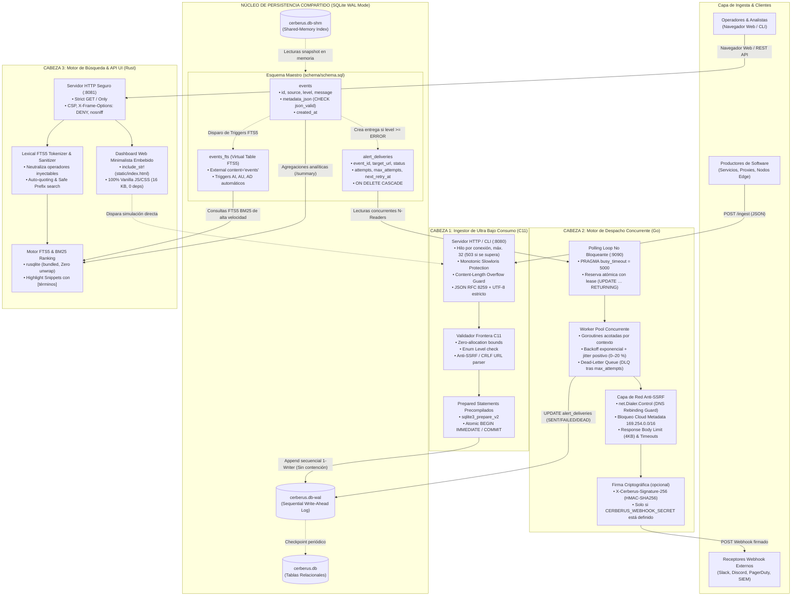

# Cerberus — Polyglot Telemetry, Alerting & Search Engine

<p align="center">
  
  
  
  
  <a href="https://github.com/juancruzgentile/Cerberus/actions/workflows/ci.yml"></a>
</p>

**Cerberus** es una plataforma de observabilidad, ingesta de eventos de seguridad y despacho de alertas de alto rendimiento basada en una arquitectura políglota de tres cabezas (**C11**, **Go** y **Rust**). Cada componente fue construido en el lenguaje donde su modelo de ejecución ofrece la máxima ventaja competitiva, comunicándose de forma desacoplada y sin intermediarios pesados a través de un núcleo transaccional compartido de **SQLite en modo WAL (Write-Ahead Logging)** con búsqueda de texto completo **FTS5**.

---

## 🏛️ Arquitectura del Sistema (Las 3 Cabezas)

El sistema resuelve el problema clásico de la telemetría en nodos *edge*, entornos embebidos o servidores de bajo recurso: ¿cómo ingerir miles de eventos por segundo, despachar alertas concurrentes con reintentos y ofrecer búsqueda instantánea sobre texto libre sin levantar un cluster pesado de Kafka, Redis o Elasticsearch que consuma gigabytes de memoria?



---

## 🎯 Filosofía Políglota: ¿Por qué cada lenguaje para su tarea?

En el desarrollo de sistemas modernos, ningún lenguaje es el mejor en todos los frentes. Cerberus aprovecha las fortalezas absolutas de cada uno:

| Componente | Lenguaje | Razón Técnica de Elección | Rol en Cerberus |
|---|---|---|---|
| **`ingestor-c`** | **C11** | • Huella de memoria mínima (< 2 MB de RSS).<br/>• Cero pausas de *Garbage Collector*.<br/>• Acceso directo a llamadas al sistema POSIX (`socket`, `fcntl`, `clock_gettime`).<br/>• Compilación nativa con SQLite embebido. | Agente colector que puede correr en nodos de borde, contenedores pequeños o como demonio del sistema sin consumir recursos. |
| **`alerter-go`** | **Go 1.26** | • Modelo de concurrencia nativo con goroutines y canales.<br/>• Ecosistema de red maduro con control a nivel de socket (`net.Dialer.Control`).<br/>• Excelente manejo de cancelación distribuida con `context.Context`.<br/>• Compilación estática sin dependencias de runtime. | Despachador asíncrono y resiliente capaz de gestionar cientos de llamadas HTTP salientes en paralelo con reintentos y tolerancia a fallos. |
| **`search-rust`** | **Rust 2021** | • Seguridad de memoria garantizada en tiempo de compilación sin overhead de GC.<br/>• Tipado algebraico estricto (`Result<T, SearchError>`) que erradica excepciones no controladas.<br/>• Sanitización léxica segura de consultas.<br/>• Serialización JSON ultrarrápida con `serde`. | API de consulta y motor analítico que expone búsqueda Full-Text FTS5 con ranking BM25 y sirve la interfaz web embebida. |
| **Núcleo** | **SQLite (WAL)** | • Formato de archivo único, universal e independiente de arquitectura.<br/>• Modo WAL: 1 escritor exclusivo no bloquea a $N$ lectores concurrentes.<br/>• Extensión FTS5 nativa integrada con triggers automáticos. | Bus transaccional y almacén persistente que une los tres servicios sin requerir un cluster externo. |

---

## ⚡ Concurrencia en SQLite: Mecánica del Modo WAL

Cerberus configura explícitamente:
```sql
PRAGMA journal_mode = WAL;
PRAGMA synchronous = NORMAL;
PRAGMA foreign_keys = ON;
PRAGMA busy_timeout = 5000;
```

### ¿Por qué WAL (Write-Ahead Logging)?
En el modo tradicional de SQLite (*rollback journal*), cualquier operación de escritura bloquea la base de datos por completo para los lectores. En modo **WAL**:

1. **Lectores no bloquean a escritores:** `search-rust` puede estar ejecutando una consulta analítica pesada o un escaneo FTS5 mientras `ingestor-c` inserta nuevos eventos simultáneamente.
2. **Escritores no bloquean a lectores:** Cuando `ingestor-c` escribe, los cambios se anexan secuencialmente al archivo `cerberus.db-wal`. Los lectores (`alerter-go` y `search-rust`) continúan leyendo la última instantánea (*snapshot*) consistente desde `cerberus.db` y `cerberus.db-shm` (memoria compartida).
3. **Escritor único ordenado:** `ingestor-c` utiliza transacciones `BEGIN IMMEDIATE` y `alerter-go` actualiza el estado de la cola con `busy_timeout = 5000ms`, garantizando que ninguna actualización transaccional se pierda por colisión.

---

## 🛡️ Matriz de Amenazas y Seguridad Defensiva (SecOps)

Cada vector de ataque cuenta con una mitigación y pruebas automatizadas. Esta tabla describe lo que el código hace y lo que las pruebas comprueban; no es una certificación de ausencia de vulnerabilidades.

| Vector de Ataque / Amenaza | Riesgo | Mitigación Implementada en Cerberus | Módulo / Componente |
|---|---|---|---|
| **SSRF y DNS Rebinding** | Un atacante configura una URL de webhook apuntando a `169.254.169.254` (AWS/GCP metadata) o cambia dinámicamente el registro DNS a `127.0.0.1` tras la validación. | `net.Dialer.Control` intercepta y valida la IP física resuelta **antes** del handshake TCP. Bloqueo estricto de `169.254.0.0/16`, `100.100.100.200/32`, `fd00:ec2::254`, NAT64 `64:ff9b::/96`, `0.0.0.0/8`, y RFC1918. | `alerter-go` |
| **Open Redirect SSRF** | Un endpoint externo responde con `302 Found` redirigiendo al cliente hacia un servicio interno privado. | `http.Client.CheckRedirect` aborta inmediatamente cualquier intento de redirección HTTP. | `alerter-go` |
| **Inyección de Sintaxis FTS5** | Un usuario ingresa caracteres como `" OR 1=1 --`, `NEAR(...)`, `NOT AND OR` para alterar la lógica de búsqueda en SQLite. | Sanitizador léxico en Rust (`sanitize_fts5_query`) que extrae tokens válidos, aplica prefijo seguro `*` y envuelve cada término entre comillas escapadas, limitando a un máximo de 16 tokens (`MAX_QUERY_TOKENS`). | `search-rust` |
| **Denegación de Servicio por Deep-Pagination** | Peticiones con `offset = usize::MAX` o valores astronómicos causan integer overflow en la conversión a `i64` o consumo masivo de CPU. | Validación estricta con `MAX_OFFSET = 100_000` y límite `limit <= 100`. | `search-rust` |
| **Slowloris / Conexiones Lentas** | Un cliente envía 1 byte cada varios segundos para agotar el pool de descriptores del servidor HTTP en C11. | Doble control: timeout por socket `SO_RCVTIMEO` / `SO_SNDTIMEO` sumado a un temporizador monotónico total de pared (`clock_gettime(CLOCK_MONOTONIC)`) de 2000 ms. | `ingestor-c` |
| **Contrabando HTTP e Integer Overflow** | Cabeceras `Content-Length` malformadas, duplicadas o con valores superiores a `SIZE_MAX`. | Parser manual dígito a dígito en C11 con cota fija de 32 KB (`MAX_HTTP_REQ_SIZE`), Respuestas: valor no numérico, negativo o duplicado → `400`; cuerpo > 32 KB → `413`; `POST` sin `Content-Length` → `411`; `Transfer-Encoding` → `400`. | `ingestor-c` |
| **Falsificación de Alertas (Tampering)** | El receptor del webhook no puede verificar si la alerta realmente proviene de Cerberus. | Firma HMAC-SHA256 en `X-Cerberus-Signature-256` **solo si** se define `CERBERUS_WEBHOOK_SECRET`. Sin secreto los webhooks salen **sin firma** (el alerter lo advierte al arrancar). | `alerter-go` |
| **JSON / Unicode malformado** | Texto con UTF-8 inválido o JSON roto se guarda y luego rompe a los lectores. | Parser JSON completo (RFC 8259) en C: valida todo el documento (también campos ignorados), UTF-8 estricto (RFC 3629) y decodifica `\uXXXX` con pares sustitutos. Rust lee filas antiguas inválidas sin fallar (U+FFFD). Reparación: `tools/repair_utf8.py`. | `ingestor-c`, `search-rust` |
| **Escritura cross-site (CSRF)** | Una página web cualquiera hace `POST` al ingestor local desde el navegador de la víctima. | `POST /ingest` exige `Content-Type: application/json` (`415` si no) y rechaza cualquier `Origin` no configurado (`403`). CORS solo para los orígenes de `--cors-origin` (el dashboard). | `ingestor-c` |
| **Entregas duplicadas** | Dos instancias del alerter envían la misma alerta. | Reserva atómica con vencimiento; el `UPDATE` final solo aplica si el lease sigue siendo propio. Ver *Garantías de entrega*. | `alerter-go` |
| **Inyección de Código XSS** | Mensajes o orígenes con `<script>alert(1)</script>` almacenados en SQLite se renderizan en el navegador. | Cabeceras de seguridad estrictas (`Content-Security-Policy`, `X-Frame-Options: DENY`, `nosniff`) y renderizado DOM exclusivamente con `escapeHtml` y creación segura de nodos de texto. | `search-rust` (UI) |

---

## 💻 Interfaz de Usuario Minimalista (Dashboard Embebido)

Cerberus incluye una consola web operativa de **un único archivo HTML/CSS/JS (16 KB)** embebida directamente dentro del binario compilado de Rust (`include_str!`).

```text
┌────────────────────────────────────────────────────────────────────────────────────────┐
│ 🟢 CERBERUS Telemetry & Security     [C11 :8080] [Go :9090] [Rust :8081] [SQLite WAL]  │
├────────────────────────────────────────────────────────────────────────────────────────┤
│ TOTAL EVENTS: 1,420 │ CRITICAL/ERR: 12 │ WEBHOOKS SENT: 12 │ DEAD-LETTER QUEUE: 0      │
├─────────────────────────────────────┬──────────────────────────────────────────────────┤
│ SIMULADOR DE INGESTA (C11)          │ BÚSQUEDA EN VIVO FTS5 & EVENT STREAM             │
│                                     │ ┌───────────────────────────────┐ ┌────────────┐ │
│ Source:   [payment-api            ] │ │ q: timeout*                   │ │ [CRITICAL] ▼│ │
│ Level:    [CRITICAL             ▼]  │ └───────────────────────────────┘ └────────────┘ │
│ Message:  [Gateway timeout 5000ms ] │ #12 [CRITICAL] payment-api [timeout] in ledger   │
│ Webhook:  [https://webhook.site/..] │ #11 [ERROR]    auth-service DB connection [time] │
│                                     │ #10 [INFO]     worker-node CPU ok (45%)          │
│ [ INGEST VIA C11 ]                  │                                                  │
│ ✔ Event #12 ingested successfully! │ Mostrando coincidencias ordenadas por BM25       │
└─────────────────────────────────────┴──────────────────────────────────────────────────┘
```

* **Acceso inmediato:** Disponible en `http://127.0.0.1:8081` en cuanto se inicia el sistema.
* **Auto-refresco:** Sincronización automática de métricas cada 3 segundos.
* **Búsqueda con Debounce:** Filtrado reactivo (250 ms) con resaltado visual (`<mark class="hl">`) de los términos coincidentes devueltos por SQLite FTS5.

---

## 🚀 Inicio Rápido con el Lanzador (`cerberus.sh`)

El proyecto incluye un script orquestador integral para administrar los servicios sin tener que abrir múltiples terminales:

### 1. Verificar herramientas instaladas
```bash
./cerberus.sh check
```
Comprueba presencia **y versión mínima**: `python3` (>=3.10), `make` (>=4.0), `go` (>=1.26, descargada automáticamente vía `GOTOOLCHAIN=auto`), `rustc`/`cargo` (>=1.89), además de `cc` (C11), `curl` y `flock` (obligatorios para `start`). Sale con error si falta algo o la versión es menor.

### 2. Iniciar el sistema completo
```bash
./cerberus.sh start
```
Compila los binarios si no existen y levanta las 3 cabezas en segundo plano:
* **Ingestor C11:** `http://127.0.0.1:8080` (endpoints `POST /ingest`, `GET /health`)
* **Alerter Go:** `http://127.0.0.1:9090` (endpoints `GET /health`, `GET /stats`)
* **Search Rust & Web UI:** `http://127.0.0.1:8081` (interfaz visual en `/`, `GET /search`, `GET /summary`)

### 3. Abrir la consola en el navegador
Abre **[http://127.0.0.1:8081](http://127.0.0.1:8081)** para interactuar con la plataforma.

### 4. Ejecutar una demostración automática
```bash
./cerberus.sh demo
```
Inserta eventos de prueba a través de C11, ejecuta consultas FTS5 en Rust y muestra el estado de las alertas en Go.

### 5. Ver estado y detener
```bash
./cerberus.sh status   # Ver PIDs y estado de ejecución
./cerberus.sh logs     # Inspeccionar los últimos logs de los 3 procesos
./cerberus.sh stop     # Detención limpia de todos los servicios
```

El lanzador solo detiene procesos propios: cada archivo PID guarda `pid`, tiempo de inicio y binario, y se verifican contra `/proc` antes de enviar señales (un PID reutilizado por otro programa nunca se mata). Un lock (`flock`) impide dos `start`/`stop` simultáneos, cada servicio tiene un plazo total de arranque (`CERBERUS_HEALTH_TIMEOUT`, 10 s) y, si uno falla, se detienen solo los servicios iniciados en ese intento.

### Garantías de entrega de alertas

* **Al menos una vez (at-least-once).** Cada entrega se reserva de forma atómica (`UPDATE … RETURNING` que mueve `next_retry_at` al vencimiento del lease); otra instancia no puede tomarla mientras el lease esté vigente. Si el proceso muere a mitad de envío, la entrega se reintenta al vencer el lease, por lo que **el receptor puede recibir duplicados**.
* **Idempotencia en el receptor:** todas las peticiones llevan `Idempotency-Key: cerberus-delivery-<id>` y `X-Cerberus-Delivery-ID`, estables entre reintentos. El receptor debe descartar claves ya procesadas.
* **Backoff:** `base · 2^(intento-1)` más un jitter positivo de 0–20 %, con tope en `MaxBackoff` (no es *Full Jitter*).
* **Firma:** HMAC-SHA256 solo con `CERBERUS_WEBHOOK_SECRET`; sin él, los mensajes van sin firma.

---

## 📡 Especificación de la API HTTP

### 1. Ingestor (`ingestor-c` en puerto `8080`)
* **`POST /ingest`**: Ingesta un nuevo evento en SQLite.
  ```bash
  curl -X POST http://127.0.0.1:8080/ingest \
    -H 'Content-Type: application/json' \
    -d '{
      "source": "payment-api",
      "level": "CRITICAL",
      "message": "Stripe API timeout after 5000ms",
      "metadata": {"transaction_id": "tx_9941", "retry": 3},
      "webhook_url": "https://hooks.example.com/alerts"
    }'
  ```
  **Respuesta:** `201 Created` / `{"status":"ok","event_id":142}`

  Errores: `400` JSON inválido (todo el documento se valida), UTF-8 inválido, campos faltantes/duplicados, byte NUL o `Content-Length` malformado/negativo/duplicado · `403` `Origin` no permitido · `411` sin `Content-Length` · `413` cuerpo > 32 KB · `415` `Content-Type` distinto de `application/json` · `503` más de 32 conexiones simultáneas.
* **`OPTIONS /ingest`**: preflight CORS. `204` con `Access-Control-Allow-*` solo para orígenes dados con `--cors-origin` (el lanzador pasa el del dashboard); `403` para el resto.
* **`GET /health`**: `200 OK` `{"status":"ok","service":"cerberus-ingestor"}`

### 2. Buscador & Analítica (`search-rust` en puerto `8081`)
* Opción `--ingest-url http://127.0.0.1:<puerto>`: URL del ingestor que usa el simulador del dashboard (el lanzador la pasa según `CERBERUS_INGEST_PORT`). Atiende hasta 32 conexiones en paralelo.
* **`GET /search?q=timeout*&level=CRITICAL&limit=10&offset=0`**: Búsqueda Full-Text FTS5 con ranking BM25 y snippets.
  ```json
  {
    "sanitized_query": "\"timeout\"*",
    "level": "CRITICAL",
    "source": null,
    "limit": 10,
    "offset": 0,
    "count": 1,
    "total_matches": 1,
    "results": [
      {
        "id": 142,
        "source": "payment-api",
        "level": "CRITICAL",
        "message": "Stripe API timeout after 5000ms",
        "snippet": "Stripe API [timeout] after 5000ms",
        "metadata_json": "{\"transaction_id\":\"tx_9941\",\"retry\":3}",
        "created_at": 1793140341,
        "rank": -1.0620689655172414e-6
      }
    ]
  }
  ```
* **`GET /summary`**: Métricas agregadas por severidad, orígenes top y estado de la cola de webhooks.
* **`GET /`**: Retorna el dashboard interactivo en HTML5/JS vanilla.

### 3. Observabilidad de Alertas (`alerter-go` en puerto `9090`)
* **`GET /stats`**: Métricas de entrega de webhooks:
  ```json
  {"pending": 0, "sent": 14, "failed": 1, "dead": 0, "total": 15}
  ```

---

## 🧪 Batería de Pruebas

Todas las suites se ejecutan de forma orquestada con:
```bash
make test
```

| Módulo | Pruebas Unitarias & Integración | Pruebas de Seguridad / Ataque Red Team | Resultado |
|---|---|---|---|
| **`schema/`** | • WAL mode & Foreign Keys activas.<br/>• CRUD y sincronización FTS5 por triggers.<br/>• Restricciones de longitud y niveles.<br/>• Borrado en cascada `ON DELETE CASCADE`. | • Payloads de inyección SQL en todos los campos.<br/>• Bombas lógicas (>16KB JSON, >8KB texto).<br/>• Rechazo de JSON escalar/arrays.<br/>• Bloqueo de SSRF y URLs malformadas.<br/>• Auditoría de permisos `0600` e higiene de secretos. | **9 / 9 PASS** |
| **`ingestor-c/`** | • Permisos restrictivos `0600` en `.db`.<br/>• Inserción de 5 niveles de severidad.<br/>• Reglas de creación atómica en `alert_deliveries`.<br/>• Ingesta masiva por lotes (`cerberus_ingest_batch`) y *rollback* ante fallo.<br/>• Self-test integrado en el binario CLI. | • Inmunidad ante `SIGPIPE` en desconexiones abruptas.<br/>• Desbordamiento de enteros en `Content-Length`.<br/>• Bloqueo de payloads de 100 KB (`413 Payload Too Large`).<br/>• Ataques Slowloris y clientes lentos.<br/>• Evasión de SSRF con IPs decimales/hexadecimales.<br/>• Regresiones de auditoría: UTF-8 inválido, `\uXXXX`/emoji, JSON inválido en campos ignorados, CORS, conexión ociosa, 64 ingestas en paralelo, permisos con `umask 022`. | **20 tests + autotest** |
| **`alerter-go/`** | • Entrega exitosa con verificación de firma HMAC-SHA256.<br/>• Recuperación tras fallo transitorio (`500` / timeout).<br/>• Transición automática a Dead-Letter Queue (`DEAD`).<br/>• Worker pool concurrente (26 alertas simultáneas sin `SQLITE_BUSY`). | • Bloqueo de DNS Rebinding en `net.Dialer.Control`.<br/>• Bloqueo de Open Redirect (`301`/`302`/`303`/`307`/`308`, cada código verificado).<br/>• Bombas de respuesta HTTP de 10 MB (Tar Pit).<br/>• Truncamiento seguro de errores en límites de runes UTF-8.<br/>• Timeouts de cabecera anti-Slowloris en métricas.<br/>• Regresiones: dos instancias sin entregas duplicadas, lease perdido, base `0600`. | **14 tests** |
| **`search-rust/`** | • Indexación y ordenamiento por relevancia BM25.<br/>• Búsqueda por prefijo seguro (`timeout*`).<br/>• Paginación multi-página con `total_matches`.<br/>• Validación de límites `limit` y `offset`.<br/>• Resumen analítico tipado (`get_summary`). | • Inyección de operadores FTS5 y comillas desbalanceadas.<br/>• Bloqueo de bytes nulos `%00` y caracteres de control.<br/>• DoS por bombas de tokens (`MAX_QUERY_TOKENS = 16`).<br/>• Desbordamiento de paginación (`MAX_OFFSET = 100_000`).<br/>• Enmascaramiento de errores internos en respuestas `500`.<br/>• Regresiones: filas con UTF-8 inválido, base `0600`, conexión ociosa, URL del ingestor configurable. | **24 tests** |
| **E2E Pipeline** | • **Flujo Completo Políglota:** C11 ingesta eventos → Go despacha webhooks firmados con verificación HMAC → Rust indexa y entrega resultados FTS5 → flujo del dashboard (preflight CORS + POST con `Origin`). | **1 test** |

Los resultados se verifican automáticamente en cada push y pull request con GitHub Actions (`.github/workflows/ci.yml`); el badge del encabezado refleja el estado real del último commit de `main`. La E2E simula las peticiones del navegador, pero no ejecuta un navegador real.

---

## 📦 Estructura del Repositorio

```text
Cerberus/
├── cerberus.sh               # Script orquestador (check, build, start, status, demo, stop)
├── Makefile                  # Orquestador Make para compilación y pruebas globales
├── requirements.txt          # Requisitos de toolchain del sistema (0 dependencias PyPI)
├── schema/
│   ├── schema.sql            # Esquema maestro SQLite WAL + FTS5 + Triggers
│   ├── test_schema.py        # Pruebas funcionales de base de datos
│   └── test_security_schema.py# Pruebas de inyección y ataques a nivel de esquema
├── ingestor-c/               # Cabeza 1: Ingestor de baja latencia en C11
│   ├── include/              # API pública (cerberus_ingestor.h)
│   ├── src/                  # Implementación del ingestor y servidor HTTP
│   ├── tests/                # Pruebas C11 y suite de ataque contra el servidor HTTP
│   └── vendor/               # Amalgamación SQLite3 oficial (compilada localmente)
├── alerter-go/               # Cabeza 2: Despachador de alertas y webhooks en Go
│   ├── cmd/alerter/          # Punto de entrada y servidor de observabilidad
│   └── internal/dispatcher/  # Worker pool, lógica de reintentos y filtro anti-SSRF
├── search-rust/              # Cabeza 3: Buscador FTS5 y analítica en Rust
│   ├── src/                  # Motor de búsqueda, sanitizador FTS5 y servidor HTTP
│   ├── src/static/           # Dashboard Web minimalista embebido (index.html)
│   └── tests/                # Pruebas de integración y pruebas de ataque
├── tools/
│   └── repair_utf8.py        # Detecta/repara filas antiguas con UTF-8 inválido
├── tests/
│   └── test_e2e_cerberus.py  # Prueba de integración end-to-end de las tres cabezas
└── .github/                  # CI (GitHub Actions) y Dependabot
```

---

## 📜 Licencia

Distribuido bajo licencia MIT (ver [`LICENSE`](LICENSE)). Código abierto para fines educativos, investigación y bases de proyectos de infraestructura de alto rendimiento.
